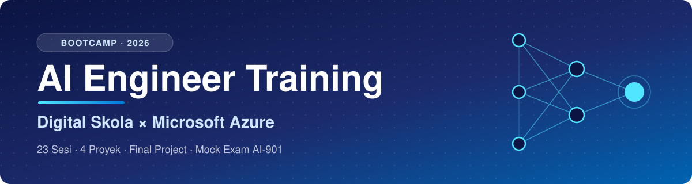

<div align="center">



<a href="#-sesi-pembelajaran--learning-sessions"></a>

  

   

🇮🇩 Bahasa Indonesia &nbsp;·&nbsp; 🇬🇧 *English in italics*

</div>

---

<div align="justify">

## 👋 Tentang Repo Ini · *About This Repo*

Repo ini mendokumentasikan perjalanan saya mengikuti bootcamp **AI Engineer** di Digital Skola dengan fokus ekosistem **Microsoft Azure**: mulai dari dasar Python dan data, LLM dan RAG, *agentic AI*, sampai *deployment* dan MLOps. Setiap sesi punya halaman sendiri berisi ringkasan materi, catatan, dan tugas.

*This repo documents my journey through Digital Skola's **AI Engineer** bootcamp, focused on the **Microsoft Azure** ecosystem: from Python and data fundamentals, LLMs and RAG, and agentic AI, all the way to deployment and MLOps. Every session has its own page with a summary, notes, and assignments.*

<div align="center">

**📈 Progres · *Progress***

`███░░░░░░░░░░░░░░░░░` **17%** &nbsp;<sub>(4 dari 23 sesi selesai · *4 of 23 sessions done*)</sub>

</div>

## 🧰 Tech Stack

<div align="center">

**Cloud & AI · *Cloud & AI***<br>
      

**Bahasa & Data · *Language & Data***<br>
   

**Framework & Tools**<br>
    

</div>

## 🗺️ Peta Belajar · *Learning Roadmap*

<table>
<tr>
<td align="center" width="33%">

### 🐍 Fase 1
**Fondasi Python, Data & Azure**<br>
<i>Python, Data & Azure Foundations</i>

<sub>Sesi 1–12 · 28 Okt – 23 Nov</sub>

Python · OOP · Git · Pandas<br>SQL · FastAPI · Azure OpenAI

🛠️ Project 1 &nbsp; 🔁 Project 2

</td>
<td align="center" width="33%">

### 🧠 Fase 2
**LLM, RAG & Agentic AI**<br>
<i>LLM, RAG & Agentic AI</i>

<sub>Sesi 13–18 · 25 Nov – 7 Des</sub>

AI Search · RAG · LangChain<br>Speech · Agents · Docker

🤖 Project 3

</td>
<td align="center" width="33%">

### 🚀 Fase 3
**Deployment, MLOps & Final**<br>
<i>Deployment, MLOps & Final</i>

<sub>Sesi 19–23 · 9 – 23 Des</sub>

Cloud Deployment · MLOps<br>AI Security · AI-901

🏗️ Project 4 &nbsp; 🏆 Final Project

</td>
</tr>
</table>

## 📚 Sesi Pembelajaran · *Learning Sessions*

Klik tiap sesi untuk melihat ringkasannya. Semua sesi berlangsung **19.15 – 21.15 WIB**. ⭐ = sesi proyek.<br>
*Click a session to expand its summary. All sessions run **7:15 – 9:15 PM (UTC+7)**. ⭐ = project session.*

<sub>✅ Selesai · *Done* &nbsp;&nbsp; 🔄 Berlangsung · *In progress* &nbsp;&nbsp; ⏳ Akan datang · *Upcoming*</sub>


### 🐍 Fase 1 · Fondasi Python, Data & Azure
<sub><i>Phase 1 · Python, Data & Azure Foundations</i> · Sesi 1–12 · 28 Oktober – 23 November 2026</sub>

<details>
<summary>✅ <b>Sesi 01</b> &nbsp;👋 <b>Get to Know Digital Skola</b> &nbsp;<sub>· Rabu, 28 Oktober 2026</sub></summary>
<br>

<table><tr><td>

Perkenalan program, mentor, sesama peserta, alur belajar 23 sesi, serta aturan tugas dan penilaian.<br>
<i>Introduction to the program, mentors, and fellow participants, the 23-session learning path, and the rules for assignments and grading.</i>


📂 <a href="sesi-01-get-to-know-digital-skola/"><b>Buka catatan & tugas</b> · <i>Open notes & assignments</i> →</a>

</td></tr></table>

</details>

<details>
<summary>✅ <b>Sesi 02</b> &nbsp;☁️ <b>Intro to Azure AI Engineering</b> &nbsp;<sub>· Jumat, 30 Oktober 2026</sub></summary>
<br>

<table><tr><td>

Gambaran peran AI Engineer dan layanan AI di Azure: Azure OpenAI, AI Foundry, AI Search, dan AI Services.<br>
<i>An overview of the AI Engineer role and Azure's AI services: Azure OpenAI, AI Foundry, AI Search, and AI Services.</i>

 

📂 <a href="sesi-02-intro-azure-ai-engineering/"><b>Buka catatan & tugas</b> · <i>Open notes & assignments</i> →</a>

</td></tr></table>

</details>

<details>
<summary>✅ <b>Sesi 03</b> &nbsp;🐍 <b>Python I: Dasar Pemrograman</b> &nbsp;<sub>· Senin, 2 November 2026</sub></summary>
<br>

<table><tr><td>

Dasar Python: variabel, tipe data, operator, percabangan, perulangan, dan struktur data bawaan (<i>list</i>, <i>dict</i>, <i>tuple</i>, <i>set</i>).<br>
<i>Python basics: variables, data types, operators, conditionals, loops, and built-in data structures (list, dict, tuple, set).</i>

 

📂 <a href="sesi-03-python-dasar-pemrograman/"><b>Buka catatan & tugas</b> · <i>Open notes & assignments</i> →</a>

</td></tr></table>

</details>

<details>
<summary>✅ <b>Sesi 04</b> &nbsp;🧩 <b>Python II: Fungsi & OOP</b> &nbsp;<sub>· Rabu, 4 November 2026</sub></summary>
<br>

<table><tr><td>

Fungsi, modul, penanganan <i>error</i>, dan pemrograman berorientasi objek (<i>class</i>, <i>inheritance</i>, <i>encapsulation</i>).<br>
<i>Functions, modules, error handling, and object-oriented programming (classes, inheritance, encapsulation).</i>


📂 <a href="sesi-04-python-fungsi-oop/"><b>Buka catatan & tugas</b> · <i>Open notes & assignments</i> →</a>

</td></tr></table>

</details>

<details>
<summary>🔄 <b>Sesi 05</b> &nbsp;🌿 <b>Git & GitHub</b> &nbsp;<sub>· Jumat, 6 November 2026</sub></summary>
<br>

<table><tr><td>

<i>Version control</i> dengan Git (<i>commit</i>, <i>branch</i>, <i>merge</i>) dan kolaborasi lewat GitHub (<i>pull request</i>, <i>issue</i>).<br>
<i>Version control with Git (commit, branch, merge) and collaboration on GitHub (pull requests, issues).</i>

 

📂 <a href="sesi-05-git-github/"><b>Buka catatan & tugas</b> · <i>Open notes & assignments</i> →</a>

</td></tr></table>

</details>

<details>
<summary>⏳ <b>Sesi 06</b> &nbsp;🐼 <b>Data Wrangling dengan Pandas</b> &nbsp;<sub>· Senin, 9 November 2026</sub></summary>
<br>

<table><tr><td>

Membaca, membersihkan, mentransformasi, dan menggabungkan data tabular dengan Pandas.<br>
<i>Reading, cleaning, transforming, and joining tabular data with Pandas.</i>

 

📂 <a href="sesi-06-data-wrangling-pandas/"><b>Buka catatan & tugas</b> · <i>Open notes & assignments</i> →</a>

</td></tr></table>

</details>

<details>
<summary>⏳ <b>Sesi 07</b> &nbsp;🛠️ <b>PROJECT 1 · Python Automation Tool</b> ⭐ &nbsp;<sub>· Rabu, 11 November 2026</sub></summary>
<br>

<table><tr><td>

Proyek pertama: membangun alat otomasi berbasis Python dari materi sesi 3–6.<br>
<i>First project: building a Python automation tool using what was covered in sessions 3–6.</i>

 

📂 <a href="sesi-07-project-1-python-automation-tool/"><b>Buka catatan & tugas</b> · <i>Open notes & assignments</i> →</a> &nbsp;·&nbsp; 🚀 <a href="proyek/01-python-automation-tool/"><b>Lihat proyek</b> · <i>View project</i> →</a>

</td></tr></table>

</details>

<details>
<summary>⏳ <b>Sesi 08</b> &nbsp;🗄️ <b>SQL for AI</b> &nbsp;<sub>· Jumat, 13 November 2026</sub></summary>
<br>

<table><tr><td>

Query SQL untuk menyiapkan data AI: <i>SELECT</i>, <i>JOIN</i>, agregasi, dan <i>window function</i>.<br>
<i>SQL queries for preparing AI data: SELECT, JOIN, aggregation, and window functions.</i>


📂 <a href="sesi-08-sql-for-ai/"><b>Buka catatan & tugas</b> · <i>Open notes & assignments</i> →</a>

</td></tr></table>

</details>

<details>
<summary>⏳ <b>Sesi 09</b> &nbsp;🧹 <b>SQL Scraping & Data Cleaning Pipeline</b> &nbsp;<sub>· Senin, 16 November 2026</sub></summary>
<br>

<table><tr><td>

Mengambil data dari web/sumber eksternal lalu membangun <i>pipeline</i> pembersihan data yang bisa diulang.<br>
<i>Collecting data from the web or external sources, then building a repeatable data-cleaning pipeline.</i>

  

📂 <a href="sesi-09-sql-scraping-data-cleaning-pipeline/"><b>Buka catatan & tugas</b> · <i>Open notes & assignments</i> →</a>

</td></tr></table>

</details>

<details>
<summary>⏳ <b>Sesi 10</b> &nbsp;⚡ <b>API & FastAPI untuk AI</b> &nbsp;<sub>· Rabu, 18 November 2026</sub></summary>
<br>

<table><tr><td>

Konsep REST API dan membangun <i>endpoint</i> layanan AI dengan FastAPI.<br>
<i>REST API concepts and building AI service endpoints with FastAPI.</i>

 

📂 <a href="sesi-10-api-fastapi-untuk-ai/"><b>Buka catatan & tugas</b> · <i>Open notes & assignments</i> →</a>

</td></tr></table>

</details>

<details>
<summary>⏳ <b>Sesi 11</b> &nbsp;🔁 <b>PROJECT 2 · End-to-End Data Pipeline</b> ⭐ &nbsp;<sub>· Jumat, 20 November 2026</sub></summary>
<br>

<table><tr><td>

Proyek kedua: <i>pipeline</i> data utuh dari pengambilan, pembersihan, penyimpanan, sampai disajikan lewat API.<br>
<i>Second project: a complete data pipeline, from ingestion and cleaning to storage and serving through an API.</i>

  

📂 <a href="sesi-11-project-2-end-to-end-data-pipeline/"><b>Buka catatan & tugas</b> · <i>Open notes & assignments</i> →</a> &nbsp;·&nbsp; 🚀 <a href="proyek/02-end-to-end-data-pipeline/"><b>Lihat proyek</b> · <i>View project</i> →</a>

</td></tr></table>

</details>

<details>
<summary>⏳ <b>Sesi 12</b> &nbsp;💬 <b>NLP & LLM di Azure OpenAI</b> &nbsp;<sub>· Senin, 23 November 2026</sub></summary>
<br>

<table><tr><td>

Dasar NLP dan LLM, <i>prompt engineering</i>, serta memanggil model lewat Azure OpenAI.<br>
<i>NLP and LLM fundamentals, prompt engineering, and calling models through Azure OpenAI.</i>

  

📂 <a href="sesi-12-nlp-llm-azure-openai/"><b>Buka catatan & tugas</b> · <i>Open notes & assignments</i> →</a>

</td></tr></table>

</details>


### 🧠 Fase 2 · LLM, RAG & Agentic AI
<sub><i>Phase 2 · LLM, RAG & Agentic AI</i> · Sesi 13–18 · 25 November – 7 Desember 2026</sub>

<details>
<summary>⏳ <b>Sesi 13</b> &nbsp;🔎 <b>Azure AI Search & Semantic Search</b> &nbsp;<sub>· Rabu, 25 November 2026</sub></summary>
<br>

<table><tr><td>

Membuat indeks dokumen di Azure AI Search, <i>embedding</i>, <i>vector search</i>, dan <i>semantic ranking</i>.<br>
<i>Building document indexes in Azure AI Search, embeddings, vector search, and semantic ranking.</i>

 

📂 <a href="sesi-13-azure-ai-search-semantic-search/"><b>Buka catatan & tugas</b> · <i>Open notes & assignments</i> →</a>

</td></tr></table>

</details>

<details>
<summary>⏳ <b>Sesi 14</b> &nbsp;📚 <b>RAG di Azure AI Foundry (LangChain)</b> &nbsp;<sub>· Jumat, 27 November 2026</sub></summary>
<br>

<table><tr><td>

<i>Retrieval-Augmented Generation</i>: menggabungkan pencarian dokumen dengan LLM memakai LangChain di Azure AI Foundry.<br>
<i>Retrieval-Augmented Generation: combining document retrieval with an LLM using LangChain on Azure AI Foundry.</i>

  

📂 <a href="sesi-14-rag-azure-ai-foundry-langchain/"><b>Buka catatan & tugas</b> · <i>Open notes & assignments</i> →</a>

</td></tr></table>

</details>

<details>
<summary>⏳ <b>Sesi 15</b> &nbsp;🤖 <b>PROJECT 3 · AI-Powered Chatbot (RAG) di Azure</b> ⭐ &nbsp;<sub>· Senin, 30 November 2026</sub></summary>
<br>

<table><tr><td>

Proyek ketiga: <i>chatbot</i> berbasis RAG yang menjawab pertanyaan dari kumpulan dokumen sendiri.<br>
<i>Third project: a RAG chatbot that answers questions from your own document collection.</i>

  

📂 <a href="sesi-15-project-3-ai-chatbot-rag-azure/"><b>Buka catatan & tugas</b> · <i>Open notes & assignments</i> →</a> &nbsp;·&nbsp; 🚀 <a href="proyek/03-ai-chatbot-rag-azure/"><b>Lihat proyek</b> · <i>View project</i> →</a>

</td></tr></table>

</details>

<details>
<summary>⏳ <b>Sesi 16</b> &nbsp;🎙️ <b>Speech & Information Extraction</b> &nbsp;<sub>· Rabu, 2 Desember 2026</sub></summary>
<br>

<table><tr><td>

Mengubah suara jadi teks (dan sebaliknya) serta mengekstrak informasi terstruktur dari dokumen, gambar, dan audio dengan Azure Content Understanding.<br>
<i>Speech-to-text and text-to-speech, plus extracting structured information from documents, images, and audio with Azure Content Understanding.</i>

 

📂 <a href="sesi-16-speech-information-extraction/"><b>Buka catatan & tugas</b> · <i>Open notes & assignments</i> →</a>

</td></tr></table>

</details>

<details>
<summary>⏳ <b>Sesi 17</b> &nbsp;🕹️ <b>Agentic AI + Azure AI Foundry Agent Service</b> &nbsp;<sub>· Jumat, 4 Desember 2026</sub></summary>
<br>

<table><tr><td>

Konsep <i>AI agent</i> (<i>tool calling</i>, perencanaan, memori) dan membangunnya dengan Azure AI Foundry Agent Service.<br>
<i>AI agent concepts (tool calling, planning, memory) and building agents with Azure AI Foundry Agent Service.</i>

 

📂 <a href="sesi-17-agentic-ai-foundry-agent-service/"><b>Buka catatan & tugas</b> · <i>Open notes & assignments</i> →</a>

</td></tr></table>

</details>

<details>
<summary>⏳ <b>Sesi 18</b> &nbsp;🐳 <b>Docker untuk AI + Azure Container Registry</b> &nbsp;<sub>· Senin, 7 Desember 2026</sub></summary>
<br>

<table><tr><td>

Mengemas aplikasi AI ke dalam <i>container</i> Docker dan menyimpan <i>image</i>-nya di Azure Container Registry.<br>
<i>Packaging AI applications as Docker containers and storing the images in Azure Container Registry.</i>

 

📂 <a href="sesi-18-docker-azure-container-registry/"><b>Buka catatan & tugas</b> · <i>Open notes & assignments</i> →</a>

</td></tr></table>

</details>


### 🚀 Fase 3 · Deployment, MLOps & Final Project
<sub><i>Phase 3 · Deployment, MLOps & Final Project</i> · Sesi 19–23 · 9 Desember – 23 Desember 2026</sub>

<details>
<summary>⏳ <b>Sesi 19</b> &nbsp;🌐 <b>Azure Cloud Deployment</b> &nbsp;<sub>· Rabu, 9 Desember 2026</sub></summary>
<br>

<table><tr><td>

Men-<i>deploy</i> aplikasi AI ke Azure (mis. App Service atau Container Apps), termasuk konfigurasi dan <i>secret</i>.<br>
<i>Deploying AI applications to Azure (e.g. App Service or Container Apps), including configuration and secrets.</i>

 

📂 <a href="sesi-19-azure-cloud-deployment/"><b>Buka catatan & tugas</b> · <i>Open notes & assignments</i> →</a>

</td></tr></table>

</details>

<details>
<summary>⏳ <b>Sesi 20</b> &nbsp;🏗️ <b>PROJECT 4 · Azure-Based AI Infrastructure</b> ⭐ &nbsp;<sub>· Jumat, 11 Desember 2026</sub></summary>
<br>

<table><tr><td>

Proyek keempat: merancang dan menyiapkan infrastruktur AI di Azure dari <i>container</i> sampai <i>deployment</i>.<br>
<i>Fourth project: designing and provisioning AI infrastructure on Azure, from containers to deployment.</i>

  

📂 <a href="sesi-20-project-4-azure-ai-infrastructure/"><b>Buka catatan & tugas</b> · <i>Open notes & assignments</i> →</a> &nbsp;·&nbsp; 🚀 <a href="proyek/04-azure-ai-infrastructure/"><b>Lihat proyek</b> · <i>View project</i> →</a>

</td></tr></table>

</details>

<details>
<summary>⏳ <b>Sesi 21</b> &nbsp;🛡️ <b>MLOps di Azure & AI Security</b> &nbsp;<sub>· Senin, 14 Desember 2026</sub></summary>
<br>

<table><tr><td>

Siklus hidup model (pelacakan eksperimen, <i>deployment</i>, <i>monitoring</i>) serta keamanan dan <i>Responsible AI</i> di Azure.<br>
<i>The model lifecycle (experiment tracking, deployment, monitoring) plus security and Responsible AI on Azure.</i>

  

📂 <a href="sesi-21-mlops-azure-ai-security/"><b>Buka catatan & tugas</b> · <i>Open notes & assignments</i> →</a>

</td></tr></table>

</details>

<details>
<summary>⏳ <b>Sesi 22</b> &nbsp;🎯 <b>Final Project · Integrasi + Mock Exam AI-901</b> ⭐ &nbsp;<sub>· Rabu, 16 Desember 2026</sub></summary>
<br>

<table><tr><td>

Menyatukan seluruh materi dalam <i>final project</i> dan latihan ujian sertifikasi AI-901.<br>
<i>Bringing all the material together in the final project, plus a practice exam for the AI-901 certification.</i>

 

📂 <a href="sesi-22-final-project-mock-exam-ai-901/"><b>Buka catatan & tugas</b> · <i>Open notes & assignments</i> →</a> &nbsp;·&nbsp; 🚀 <a href="proyek/final-project/"><b>Lihat proyek</b> · <i>View project</i> →</a>

</td></tr></table>

</details>

<details>
<summary>⏳ <b>Sesi 23</b> &nbsp;🏆 <b>Final Project Showcase</b> ⭐ &nbsp;<sub>· Rabu, 23 Desember 2026</sub></summary>
<br>

<table><tr><td>

Presentasi <i>final project</i> di depan mentor dan peserta lain.<br>
<i>Presenting the final project to mentors and fellow participants.</i>


📂 <a href="sesi-23-final-project-showcase/"><b>Buka catatan & tugas</b> · <i>Open notes & assignments</i> →</a> &nbsp;·&nbsp; 🚀 <a href="proyek/final-project/"><b>Lihat proyek</b> · <i>View project</i> →</a>

</td></tr></table>

</details>

## 🏆 Proyek · *Projects*

Kode tiap proyek ada di folder [`proyek/`](proyek/). Final Project dikerjakan di repository terpisah.<br>
*Each project's code lives in the [`proyek/`](proyek/) folder. The Final Project has its own repository.*

| | Proyek · *Project* | Sesi | Teknologi · *Tech* | Status |
|:-:|---|:-:|---|:-:|
| 🛠️ | [PROJECT 1 · Python Automation Tool](proyek/01-python-automation-tool/) | 7 |   | ⏳ |
| 🔁 | [PROJECT 2 · End-to-End Data Pipeline](proyek/02-end-to-end-data-pipeline/) | 11 |    | ⏳ |
| 🤖 | [PROJECT 3 · AI-Powered Chatbot (RAG) di Azure](proyek/03-ai-chatbot-rag-azure/) | 15 |    | ⏳ |
| 🏗️ | [PROJECT 4 · Azure-Based AI Infrastructure](proyek/04-azure-ai-infrastructure/) | 20 |    | ⏳ |
| 🏆 | [Final Project · SIAGA NUSA](proyek/final-project/) | 2–23 |    | ⏳ |

## 📂 Struktur Repo · *Repository Structure*

```
.
├── README.md                  ← halaman ini · this page
├── assets/                    ← banner & gambar · banner & images
├── proyek/                    ← kode proyek · project code
│   ├── 01-python-automation-tool/
│   ├── ...
│   └── final-project/         ← tautan ke repo terpisah · link to separate repo
├── sesi-01-get-to-know-digital-skola/
│   ├── README.md              ← ringkasan & catatan · summary & notes
│   ├── notebooks/             ← latihan · practice notebooks
│   └── tugas/                 ← tugas · assignments
├── ...
└── sesi-23-final-project-showcase/
```

</div>

---

<div align="center">

<sub>Materi pelatihan © Digital Skola. Repo ini berisi catatan dan hasil kerja pribadi selama pelatihan.<br>
<i>Training materials © Digital Skola. This repo contains my personal notes and work from the training.</i></sub>

<br><br>

⭐ **Kalau repo ini bermanfaat, beri bintang ya!** · *If you find this useful, give it a star!*

</div>
