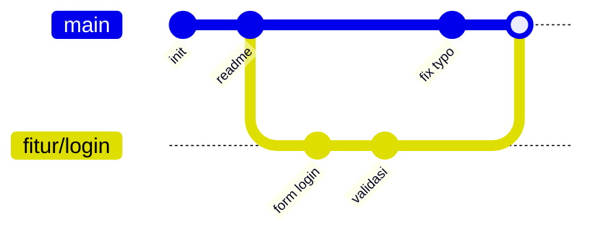

<div align="center">

<sub><a href="../">🏠 Beranda · <i>Home</i></a></sub>

# 🌿 Sesi 05 — Git & GitHub

  

  

<sub>🐍 Fase 1 · Fondasi Python, Data & Azure · <i>Phase 1 · Python, Data & Azure Foundations</i></sub>

</div>

---

<div align="justify">

## 📌 Tentang Sesi · *About This Session*

📅 **Jumat, 6 November 2026** · 19.15 – 21.15 WIB<br>
*Friday, November 6, 2026 · 7:15 – 9:15 PM (UTC+7)*

<i>Version control</i> dengan Git (<i>commit</i>, <i>branch</i>, <i>merge</i>) dan kolaborasi lewat GitHub (<i>pull request</i>, <i>issue</i>).<br>
*Version control with Git (commit, branch, merge) and collaboration on GitHub (pull requests, issues).*

## 🧠 Yang Dipelajari · *What I Learned*

Sesi ini membahas cara melacak perubahan kode dan bekerja sama dalam tim. Materinya dimulai dari konsep *version control* dan arsitekturnya, lalu tiga ruang kerja Git, perintah dasar CLI, *branching* & *merging*, *pull request*, dan diakhiri dengan *best practice*.<br>
*This session covered how to track code changes and work together as a team. It started with the idea of version control and its architectures, then Git's three working areas, the basic CLI commands, branching & merging, pull requests, and finally best practices.*

### 🕰️ 1. Version Control System (VCS)

**VCS** adalah sistem yang mencatat setiap perubahan pada berkas dari waktu ke waktu. Dengan VCS kita bisa melihat siapa mengubah apa dan kapan, kembali ke versi sebelumnya, dan mengerjakan beberapa fitur sekaligus tanpa saling menimpa.<br>
***A VCS** is a system that records every change to a set of files over time. With it we can see who changed what and when, roll back to an earlier version, and work on several features at once without overwriting each other.*

Tanpa VCS, kita berakhir dengan berkas seperti `laporan_final.py`, `laporan_final_revisi.py`, dan `laporan_final_BENERAN.py`, tanpa tahu apa beda isinya.<br>
*Without a VCS we end up with files like `report_final.py`, `report_final_revised.py`, and `report_final_REALLY.py`, with no idea what actually differs between them.*

💡 *Analogi:* seperti fitur *save game* yang menyimpan banyak titik. Kalau salah langkah, kita bisa kembali ke titik simpan mana pun, bukan hanya ke yang terakhir.<br>
*Analogy: like a game with many save points. If something goes wrong you can load any save point, not just the latest one.*

### 🏛️ 2. Arsitektur VCS · *VCS Architectures*

| | 🏢 Terpusat · *Centralized* | 🌐 Terdistribusi · *Distributed* |
|---|---|---|
| **Cara kerja · *How it works*** | Riwayat lengkap hanya ada di satu server. Pengguna mengambil salinan berkas terbaru saja.<br>*The full history lives on one server. Users only check out the latest files.* | Setiap pengguna punya salinan **repository lengkap** beserta seluruh riwayatnya.<br>*Every user has a **complete copy of the repository**, including its full history.* |
| **Bekerja *offline* · *Offline work*** | Tidak bisa *commit* tanpa koneksi ke server.<br>*Can't commit without a connection to the server.* | Bisa *commit*, melihat riwayat, dan membuat *branch* tanpa internet.<br>*Can commit, browse history, and create branches with no internet.* |
| **Risiko · *Risk*** | Server mati atau rusak berarti seluruh tim terhenti dan riwayat bisa hilang.<br>*If the server goes down or breaks, the whole team stops and history can be lost.* | Setiap salinan berfungsi sebagai *backup*.<br>*Every copy doubles as a backup.* |
| **Contoh · *Examples*** | SVN, Perforce | **Git**, Mercurial |

GitHub adalah layanan *hosting* untuk repository Git. Ia menjadi titik kumpul tim (*remote*), tetapi Git tetap terdistribusi: repository di laptop kita sama lengkapnya.<br>
*GitHub is a hosting service for Git repositories. It acts as the team's meeting point (the remote), but Git stays distributed: the repository on our laptop is just as complete.*

### 🗂️ 3. Tiga Ruang Utama Git · *Git's Three Main Areas*

```
 Working Directory  ──git add──▶  Staging Area  ──git commit──▶  Git Repository
  (berkas yang diedit)            (perubahan siap                (riwayat commit
   files being edited)             di-commit · ready)             · commit history)
        ▲                                                               │
        └──────────────────── git restore / git switch ◀───────────────┘
```

| Ruang · *Area* | Isi · *Contents* |
|---|---|
| 1. **Working Directory** | Berkas di folder proyek yang sedang kita ubah. Perubahan di sini belum dicatat Git.<br>*The files in the project folder that we're editing. Changes here aren't recorded by Git yet.* |
| 2. **Staging Area** (*index*) | Daftar perubahan yang kita pilih untuk masuk ke *commit* berikutnya. Kita bisa memilih sebagian berkas saja.<br>*The list of changes we've picked for the next commit. We can pick just some of the files.* |
| 3. **Git Repository** (`.git`) | Database riwayat *commit*. Setiap *commit* adalah *snapshot* proyek dengan ID unik (*hash*), penulis, waktu, dan pesan.<br>*The commit history database. Each commit is a project snapshot with a unique ID (hash), author, time, and message.* |

💡 *Analogi:* seperti mengirim paket. *Working directory* itu meja tempat barang disiapkan, *staging area* itu kardus yang sedang diisi, dan *commit* itu kardus yang sudah dilakban dan diberi label, siap dikirim.<br>
*Analogy: like shipping a parcel. The working directory is the table where items are laid out, the staging area is the box being packed, and a commit is the box taped shut and labelled, ready to ship.*

### ⌨️ 4. Perintah Dasar Git CLI · *Basic Git CLI Commands*

| Perintah · *Command* | Fungsi · *Purpose* |
|---|---|
| `git config --global user.name "..."`<br>`git config --global user.email "..."` | Mengatur identitas penulis *commit* (sekali per komputer).<br>*Sets the commit author identity (once per computer).* |
| `git init` | Membuat repository baru di folder saat ini.<br>*Creates a new repository in the current folder.* |
| `git clone <url>` | Menyalin repository dari GitHub beserta riwayatnya.<br>*Copies a repository from GitHub with its history.* |
| `git status` | Menampilkan berkas yang berubah, yang sudah di-*stage*, dan yang belum dilacak.<br>*Shows changed, staged, and untracked files.* |
| `git add <berkas>` / `git add .` | Memasukkan perubahan ke *staging area*.<br>*Moves changes into the staging area.* |
| `git commit -m "pesan"` | Menyimpan isi *staging area* sebagai *commit* baru.<br>*Saves the staging area as a new commit.* |
| `git log --oneline` | Menampilkan riwayat *commit* secara ringkas.<br>*Shows the commit history in short form.* |
| `git diff` | Menampilkan perbedaan baris yang belum di-*stage*.<br>*Shows line-level changes that aren't staged yet.* |
| `git remote add origin <url>` | Menghubungkan repository lokal ke repository di GitHub.<br>*Links the local repository to one on GitHub.* |
| `git push` / `git pull` | Mengirim *commit* ke *remote* / mengambil dan menggabungkan *commit* dari *remote*.<br>*Sends commits to the remote / fetches and merges commits from the remote.* |

```bash
git init
git add README.md
git commit -m "Add project README"
git remote add origin https://github.com/<user>/<repo>.git
git push -u origin main               # -u: ingat tujuan push untuk berikutnya
```

⚠️ `git add .` memasukkan **semua** perubahan, termasuk berkas yang tidak seharusnya ikut seperti `.env` atau dataset besar. Daftarkan berkas tersebut di `.gitignore` terlebih dahulu.<br>
*`git add .` stages **every** change, including files that shouldn't go in, such as `.env` or large datasets. List those files in `.gitignore` first.*

### 🌳 5. Branching & Merging

**Branch** adalah jalur pengembangan terpisah. Fitur baru dikerjakan di *branch* sendiri (*isolated feature*) sehingga `main` tetap stabil. Setelah selesai dan dicek, *branch* itu digabung (**merge**) kembali ke `main`.<br>
*A **branch** is a separate line of development. A new feature is built on its own branch (an isolated feature) so `main` stays stable. When it's done and checked, the branch is **merged** back into `main`.*

```bash
git switch -c fitur/login             # buat branch baru lalu pindah ke sana
# ... edit, add, commit ...
git switch main
git merge fitur/login                 # gabungkan ke main
git branch -d fitur/login             # hapus branch yang sudah digabung
```



⚠️ **Merge conflict** terjadi bila dua *branch* mengubah baris yang sama. Git menandai bagian itu dengan `<<<<<<<`, `=======`, dan `>>>>>>>`. Kita memilih isi yang benar, menghapus penandanya, lalu `git add` dan `git commit` lagi.<br>
***A merge conflict** happens when two branches change the same lines. Git marks the spot with `<<<<<<<`, `=======`, and `>>>>>>>`. We keep the right content, delete the markers, then `git add` and `git commit` again.*

Dua model *branching* yang umum · *Two common branching models*:

| | 🚆 Trunk-Based Development | 🌊 Git Flow |
|---|---|---|
| **Struktur · *Structure*** | Satu *branch* utama (`main`/*trunk*). *Branch* fitur kecil dan berumur pendek (jam sampai beberapa hari).<br>*One main branch (`main`/trunk). Feature branches are small and short-lived (hours to a few days).* | Beberapa *branch* tetap: `main` (rilis), `develop` (integrasi), ditambah `feature/*`, `release/*`, dan `hotfix/*`.<br>*Several long-lived branches: `main` (releases) and `develop` (integration), plus `feature/*`, `release/*`, and `hotfix/*`.* |
| **Rilis · *Releases*** | Sering, bahkan beberapa kali sehari, didukung CI/CD dan *feature flag*.<br>*Frequent, even several times a day, backed by CI/CD and feature flags.* | Terjadwal per versi, misalnya v1.0, v1.1.<br>*Scheduled per version, e.g. v1.0, v1.1.* |
| **Cocok untuk · *Fits*** | Tim yang rilis terus-menerus, seperti aplikasi web dan layanan *cloud*.<br>*Teams that ship continuously, such as web apps and cloud services.* | Produk dengan versi rilis jelas, seperti aplikasi *mobile* dan *library*.<br>*Products with clear release versions, such as mobile apps and libraries.* |

💡 *Analogi:* *branch* seperti salinan draf dokumen untuk dicoba-coba. Kalau hasilnya bagus, isinya dipindahkan ke dokumen utama. Kalau gagal, drafnya cukup dibuang.<br>
*Analogy: a branch is like a draft copy of a document for trying things out. If it works, the changes go into the main document; if not, you just throw the draft away.*

### 🔀 6. Pull Request (PR)

**Pull request** adalah permintaan di GitHub untuk menggabungkan satu *branch* ke *branch* lain. Sebelum di-*merge*, perubahan bisa dilihat, dikomentari, dan diuji terlebih dahulu.<br>
***A pull request** is a request on GitHub to merge one branch into another. Before the merge, the changes can be viewed, commented on, and tested.*

Alurnya · *The flow*: buat *branch* → *commit* → `git push` → buka PR di GitHub → *review* & CI → perbaiki bila perlu → *merge*.<br>
*Create a branch → commit → `git push` → open a PR on GitHub → review & CI → fix if needed → merge.*

Tiga pilar PR · *The three pillars of a PR*:

| Pilar · *Pillar* | Penjelasan · *Explanation* |
|---|---|
| 1. 🛡️ **Quality Assurance** | Rekan tim memeriksa kode sebelum masuk `main`, sehingga *bug*, celah keamanan, dan kode yang sulit dibaca bisa ditangkap lebih awal.<br>*Teammates check the code before it reaches `main`, catching bugs, security holes, and hard-to-read code early.* |
| 2. 📚 **Knowledge Sharing** | Diskusi di PR membuat lebih dari satu orang paham bagian kode tersebut, dan alasan setiap perubahan tercatat untuk dibaca nanti.<br>*The PR discussion means more than one person understands that code, and the reason for each change is recorded for later.* |
| 3. ⚙️ **Automated CI/CD** | Setiap PR bisa memicu pengujian dan pengecekan otomatis (misalnya GitHub Actions). PR baru boleh di-*merge* jika semuanya lolos, lalu bisa langsung di-*deploy*.<br>*Each PR can trigger automated tests and checks (e.g. GitHub Actions). It can only be merged once everything passes, and can then be deployed right away.* |

GitHub juga menyediakan **issue** untuk mencatat *bug*, ide, dan tugas. PR bisa menutup *issue* secara otomatis dengan menulis `Closes #12` di deskripsinya.<br>
*GitHub also offers **issues** for tracking bugs, ideas, and tasks. A PR can close an issue automatically by writing `Closes #12` in its description.*

### ✨ 7. Best Practice

- **Commit kecil dan fokus.** Satu *commit* untuk satu perubahan logis, supaya mudah di-*review* dan mudah dibatalkan.<br>
  ***Small, focused commits.** One commit per logical change, so it's easy to review and easy to revert.*
- **Pesan commit yang jelas.** Gunakan kalimat perintah yang menjelaskan *apa* yang berubah, misalnya `Add flood prediction endpoint`, bukan `update` atau `fix`.<br>
  ***Clear commit messages.** Use an imperative sentence saying what changed, e.g. `Add flood prediction endpoint`, not `update` or `fix`.*
- **Jangan langsung commit ke `main`.** Kerjakan di *branch* lalu gabungkan lewat PR.<br>
  ***Don't commit straight to `main`.** Work on a branch and merge through a PR.*
- **Gunakan `.gitignore`.** Jangan pernah meng-*commit* *secret* (API key, `.env`), folder hasil *build*, `venv`, atau dataset besar.<br>
  ***Use `.gitignore`.** Never commit secrets (API keys, `.env`), build output, `venv`, or large datasets.*
- **`git pull` sebelum mulai bekerja** agar *branch* kita selalu mengikuti versi terbaru dan *conflict* tetap kecil.<br>
  ***`git pull` before you start working** so your branch stays up to date and conflicts stay small.*
- **Tulis README yang baik.** README adalah halaman pertama yang dilihat orang. Minimal jelaskan: proyek ini apa, masalah yang diselesaikan, cara instalasi dan menjalankan, contoh penggunaan, struktur folder, dan lisensi atau kontak.<br>
  ***Write a good README.** It's the first page people see. At minimum explain what the project is, the problem it solves, how to install and run it, a usage example, the folder structure, and a license or contact.*

⚠️ API key yang terlanjur ter-*commit* tetap tersimpan di riwayat meskipun berkasnya dihapus di *commit* berikutnya. Anggap kuncinya bocor dan segera ganti (*rotate*).<br>
*An API key that has been committed stays in the history even if the file is deleted in a later commit. Treat the key as leaked and rotate it right away.*

🎯 **Kapan dipakai · *When to use*:** di setiap proyek, termasuk proyek pribadi. Untuk AI Engineer, Git dipakai untuk kode *pipeline*, *prompt*, dan konfigurasi model, sedangkan PR + CI/CD menjadi jalur aman untuk men-*deploy* ke Azure. Repo catatan ini juga memakai alur yang sama: setiap sesi selesai menjadi satu *commit* bernomor.<br>
*In every project, including personal ones. For an AI Engineer, Git tracks pipeline code, prompts, and model configs, while PRs + CI/CD give a safe path to deploy to Azure. This notes repo follows the same flow: each finished session becomes one numbered commit.*

## 📝 Tugas · *Assignments*

| # | Tugas · *Assignment* | Berkas · *Files* | Status |
|:-:|---|---|:-:|
| 1 | Membuat README yang baik dan menjelaskan isi repository<br>*Write a good README that explains the repository* | [README.md](../README.md) | ✅ |

## 💡 Catatan & Referensi · *Notes & References*

- [Pro Git Book (gratis · *free*)](https://git-scm.com/book/en/v2)
- [Git Docs: Reference](https://git-scm.com/docs)
- [GitHub Docs: About pull requests](https://docs.github.com/en/pull-requests/collaborating-with-pull-requests/proposing-changes-to-your-work-with-pull-requests/about-pull-requests)
- [GitHub Docs: About READMEs](https://docs.github.com/en/repositories/managing-your-repositorys-settings-and-features/customizing-your-repository/about-readmes)
- [Trunk Based Development](https://trunkbaseddevelopment.com/)
- [Learn Git Branching (latihan interaktif · *interactive practice*)](https://learngitbranching.js.org/)

</div>

---

<div align="center">

<a href="../sesi-04-python-fungsi-oop/">← Sesi 04</a> &nbsp;·&nbsp; <a href="../">🏠 Beranda</a> &nbsp;·&nbsp; <a href="../sesi-06-data-wrangling-pandas/">Sesi 06 →</a>

</div>
